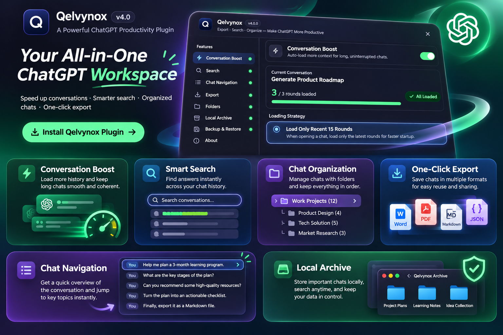
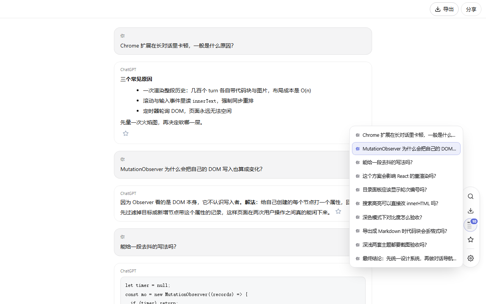
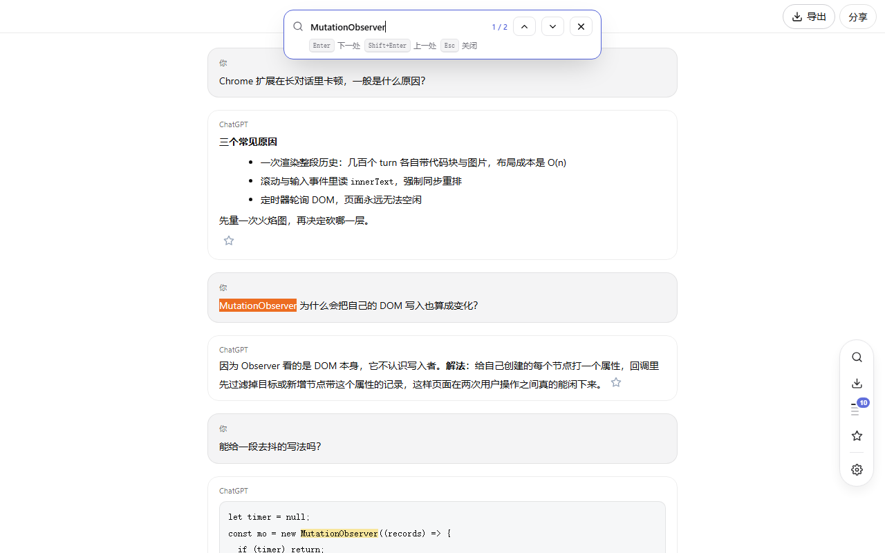
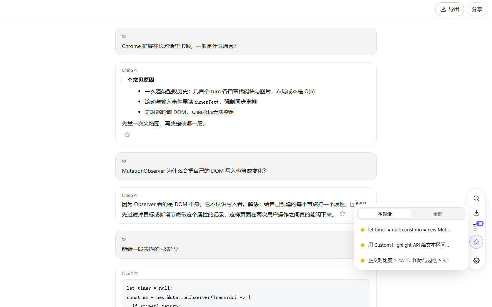
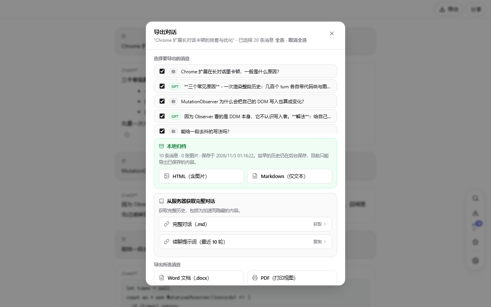
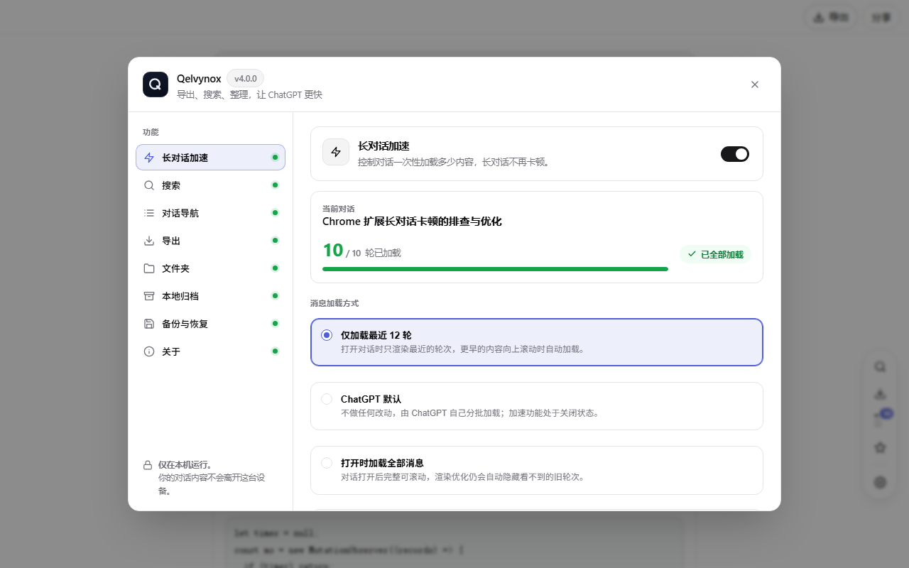
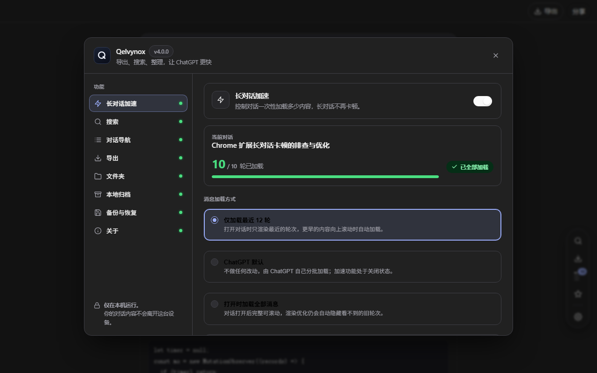

<p align="center">
  <a href="assets/qelvynox-poster-en.jpg"></a>
</p>

<h1 align="center">Qelvynox — ChatGPT speed, search &amp; export</h1>

<p align="center">
  <strong>Long ChatGPT conversations that stop lagging — and everything you can do with them afterwards.</strong><br>
  Trim heavy history, search in place, jump by question, pin replies,<br>
  and export to Word / PDF / Markdown / HTML / TXT / JSON — with images, from your own device.
</p>

<p align="center">
  <a href="#screenshots">Screenshots</a> ·
  <a href="#languages">Languages</a> ·
  <a href="README.zh-CN.md">简体中文</a> ·
  <a href="CHANGELOG.md">Changelog</a> ·
  <a href="CONTRIBUTING.md">Contributing</a> ·
  <a href="docs/privacy.md">Privacy</a>
</p>

<p align="center">
  
  
  
  
  
</p>

<p align="center">
  <a href="https://github.com/WeFode/Qelvynox">GitHub</a> ·
  <a href="https://gitee.com/lin_30_0/qelvynox">Gitee mirror</a>
</p>

> The poster above is the original launch artwork: its **Folders / 文件夹** tile and its
> `v4.0` badge are stale — the folder organizer was retired before this release, and the
> extension version is `1.0.0`. Everything shown under
> <a href="#screenshots">Screenshots</a> is rendered from the real UI.

---

Free forever. No account, no subscription, no ads, no upsell screen, no telemetry.
Everything runs in your browser and nothing you write ever leaves the device.

> Qelvynox was called **TurboGPT** previously. Existing installs carry their
> settings and bookmarks forward automatically on the first load.

---

## Screenshots

| Navigate by question | Search in place |
| --- | --- |
|  |  |

| Pinned replies | Export |
| --- | --- |
|  |  |

| Control panel (light) | Control panel (dark) |
| --- | --- |
|  |  |

---

## Languages

The interface ships in **Chinese and English**, and you switch it inside the product:
**Settings → General → 界面语言 / Interface language**, or the segmented control at the
top of the toolbar popup. It applies immediately — no reload — and is remembered.

- **Chinese is the default**, whatever your browser language is. The choice is a
  stored setting, never a guess from `navigator.language`.
- The switch covers Qelvynox's own panels, tooltips, notifications and the labels in
  exported files. Your conversation text is never translated.
- The store listing and Chrome's own extension UI are localised separately through
  `_locales/zh_CN` and `_locales/en`.

Adding a third language means one more table in `src/shared/i18n.js`, one more entry
under `_locales/`, and nothing else — no string lives anywhere else in the code.

---

## What it does

### Long-chat speed booster
ChatGPT renders every turn it has loaded, which is why a 500-message chat turns
into a slideshow. Qelvynox keeps only the most recent turns in the layout and
leaves the rest in the page's memory — **without deleting anything ChatGPT owns**.

- Older turn wrappers are hidden and the virtualizer rail is recalculated, so
  React's fibre tree stays valid. Physically removing nodes is what made ChatGPT
  throw `NotFoundError` and show "Oh no! An error occurred".
- Three loading modes: *recent turns only*, *ChatGPT default*, *load everything*.
- Scroll up and older turns reveal themselves in batches, with the reading
  position anchored to the pixel. No button, no jump.
- Background tabs do nothing at all until you come back.

### In-chat search — `Alt + F`
Type a keyword and **every** occurrence in the conversation is painted in place;
the first one is centred, `Enter` / `Shift+Enter` walk the rest.

- Painted with the browser's Custom Highlight API, so ChatGPT's DOM is never
  rewritten and React can keep re-rendering underneath it.
- The scope is every turn the page has loaded — including the ones the booster
  folded away, which are revealed on the way to a match.
- A reply that arrives while the bar is open is searched too: the bar repaints
  as the answer streams in, throttled so it never fights the page.

### Chat navigator
Hover the dock's outline button and a headerless list of your questions slides
in; click to pin it. The question nearest the middle of your viewport is
highlighted and kept in sight while you scroll, so the panel works as a position
map rather than a jump list. Split views are handled too: the list only ever
describes the conversation you are looking at, never the sum of both. Clicking a row scrolls straight to that turn with a
glowing highlight, unhiding it first if the booster had folded it away.
Rows are also tab-stops: `Tab` walks the list, `Enter` jumps.

### Response bookmarks
A star button on every assistant reply. Pinned replies live on their own dock
button with a `本对话 / 全部` switch — a bookmark from another chat opens that
chat, one from this chat jumps to it and reveals it first.

### Local conversation archive (instant export, with images)
Asking OpenAI for a conversation again is the request that gets rate-limited,
refused or cut short on a long chat. The local archive removes that request:

- Captured from the payload **ChatGPT already loads** when a chat opens — no
  extra request, no extra latency.
- Kept current as you chat: each message is saved once it finishes streaming,
  and one throttled sync pulls the newest turns with their real ids.
- Older history is filled in the background, one page at a time, resuming from
  the oldest saved page on the next visit.
- Images are stored as bytes while their signed URLs are still valid.
- Two instant exports read only from your device: a **self-contained HTML** file
  with every image embedded (opens offline, forever) and **Markdown** with a
  marker where each image was.
- Temporary chats are never archived. `Delete archive` is one click away.

### Selective export
Tick exactly which messages you want, then export to:

| Format | Notes |
| --- | --- |
| **Word (.docx)** | Genuine OOXML built from scratch — minimal ZIP writer, CRC32, no library. Code blocks keep monospace and shading. |
| **PDF** | Print view, formatted markdown rather than a flattened page. |
| **Markdown / TXT / JSON** | Structure survives: fenced code keeps its language, links keep their URLs, lists and tables keep their shape. |
| **HTML** | From the local archive, images embedded, right-to-left text laid out correctly. |

### Whole-conversation export & continuation
For a chat that hit ChatGPT's length limit and will not take another message:

- **Full conversation (.md)** walks every turn from the conversation API —
  including the ones trimmed for speed — without loading them into the page.
- **Continuation prompt** copies a ready-to-paste block with the last *N* turns
  plus an instruction to continue rather than restart.

Start a new chat, attach the `.md`, paste the prompt, carry on. If the walk
cannot finish, the export says exactly how far it got and why; a partial archive
is never presented as complete.

## Privacy & permissions

**Qelvynox does not send conversation data to the developer.** There is no analytics, no crash reporting, no
update ping, no remote feature flag, and no server of any kind in the codebase.
Your prompts, replies and images are processed in the browser and may be stored on your device. History and image requests go to OpenAI services using your current session. See [docs/privacy.md](docs/privacy.md) for the policy text and
[docs/store-listing.md](docs/store-listing.md) for the exact store disclosures.

| Permission | Why it is needed |
| --- | --- |
| Page access on `chatgpt.com` / `chat.openai.com` | That is the whole product: the toolkit renders inside the conversation. |
| `storage`, `unlimitedStorage` | Settings and the local archive are stored on the device. |
| Host access to `*.oaiusercontent.com` | Fetching image bytes for the archive. HTTPS only, ChatGPT/OpenAI hosts only, requests only accepted from this extension's own scripts. |

No `tabs`, no `activeTab`, no browsing-history access, no broad host permissions,
no remote code — every line ships inside the package.

---

## Install

**From the Chrome Web Store** (recommended): search for *Qelvynox* and click
Add to Chrome. Works in Chrome, Edge, Brave, Opera and Vivaldi.

**From source** (no build step, no dependencies):

```bash
git clone https://github.com/WeFode/Qelvynox.git     # mainland China: git clone https://gitee.com/lin_30_0/qelvynox.git
```

1. Open `chrome://extensions`, enable **Developer mode**.
2. Click **Load unpacked** and select the repository folder.
3. Open or refresh [ChatGPT](https://chatgpt.com). The dock appears on the right.

---

## Keyboard shortcuts

| Key | Action |
| --- | --- |
| `Alt + F` | Search this conversation |
| `Enter` / `Shift + Enter` | Next / previous match |
| `Tab` + `Enter` | Walk and jump the navigator list without a mouse |
| `Esc` | Close search, navigator, bookmarks, export and settings |

---

## Architecture

| Path | Role |
| --- | --- |
| `src/shared/i18n.js` | The dictionary: one parallel table per language, plus the switch, placeholder/plural handling and the popup's `data-i18n` pass. Loaded first among the content scripts. |
| `src/page/mainWorld.js` | `MAIN`-world fetch interceptor that trims conversation payloads before React renders them, and hands the original payload to the archive. |
| `src/content/index.js` | The in-page suite: dock, navigator, bookmarks, search, export, settings panel — driven by one debounced `MutationObserver`. |
| `src/content/archive.js` | The local archive: message identity, merge rules, safe HTML/Markdown builders, storage adapter. |
| `src/content/settings.css` | The settings panel's design tokens and components, namespaced under `.qgst-*` so nothing leaks into ChatGPT. |
| `src/popup/` | A compact launcher: quick switches plus the door into the in-page panel. |
| `src/background/background.js` | Settings defaults and migration, and the image fetcher for the archive. |

### Tests

```bash
node tests/run.mjs      # 11 suites, 543 assertions, zero dependencies
```

Each suite loads the **real** extension source into `node:vm` with stubbed
browser globals and drives it with a scripted network and DOM — payload
trimming, backwards pagination, turn counting, hydration, stats plumbing,
temporary chats, archive merge and safe HTML, the export pipeline, the settings
panel, live-surface refresh, the language dictionary and the release manifest.

### Preview the UI

```bash
node dev/serve.mjs      # http://127.0.0.1:8123/c/demo-chat
node dev/shots.mjs      # regenerate the screenshots above from the real UI
```

`dev/` never ships with the extension.

---

## Repository

| Host | URL | Role |
| --- | --- | --- |
| GitHub | <https://github.com/WeFode/Qelvynox> | Primary — issues and pull requests go here. |
| Gitee | <https://gitee.com/lin_30_0/qelvynox> | Mirror, for a faster clone in mainland China. |

Both remotes are configured in the maintainer's working copy as `origin` (GitHub)
and `gitee` (Gitee), on the `main` branch:

```bash
git remote add origin https://github.com/WeFode/Qelvynox.git
git remote add gitee  https://gitee.com/lin_30_0/qelvynox.git
git push -u origin main      # first push
git push -u gitee  main      # keep the mirror in step
```

---

## Publishing a release

`docs/store-listing.md` is the whole checklist: the artefacts and their exact sizes,
the English and 简体中文 listing text, the per-permission justifications, the
data-use answers and the items to verify before clicking Publish. The short version:

```bash
node tests/run.mjs      # must be green
node dev/package.mjs    # -> qelvynox-<version>.zip (no dev/, tests/, docs/, screenshots or posters)
```

Then upload that zip in the Chrome Web Store dashboard, fill both item languages from
the doc, and keep the privacy-policy URL public. The store wants a page that loads
without a login, so publish `docs/privacy.md` through GitHub Pages
(`https://<user>.github.io/Qelvynox/...`) rather than pasting a `blob` or
`raw.githubusercontent.com` link.

---

## License

[MIT](LICENSE) — free for personal and commercial use.

Copyright (c) 2026 WeFode (Qelvynox) and contributors.
Qelvynox is an independent, unofficial tool and is not affiliated with or endorsed by
OpenAI.
