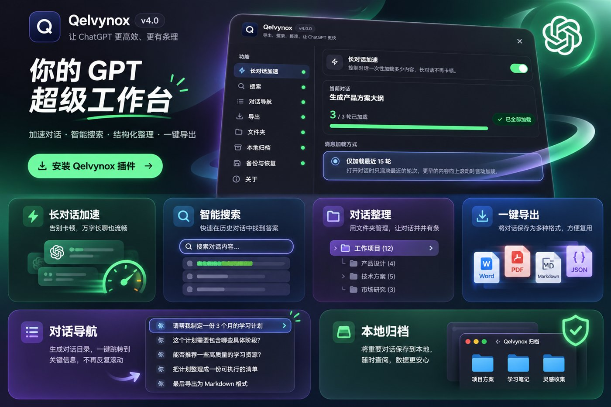
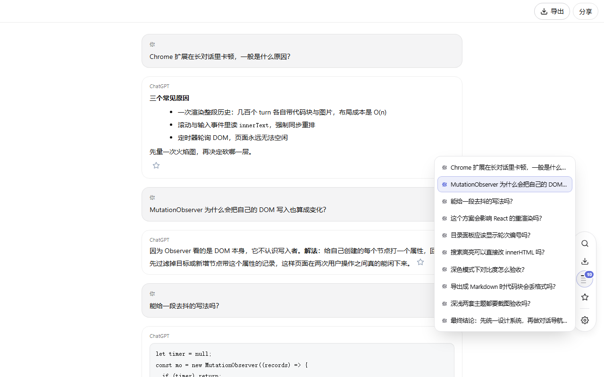
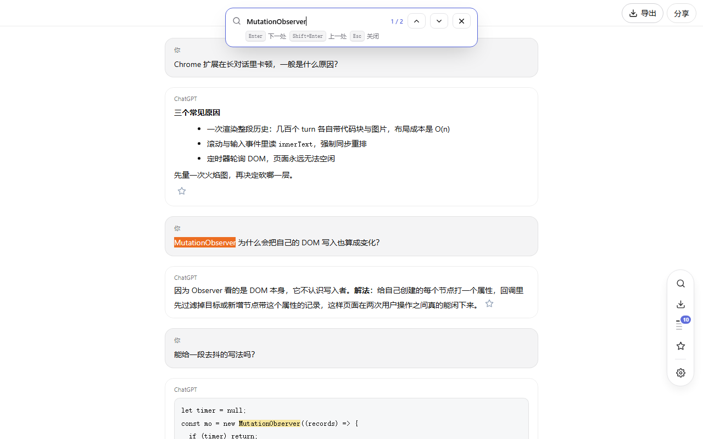
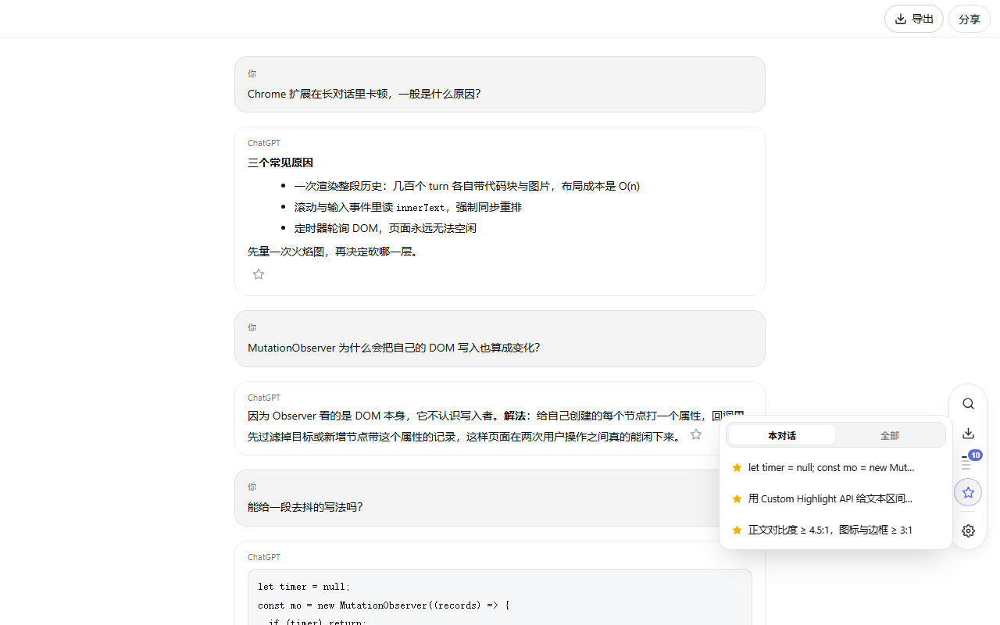
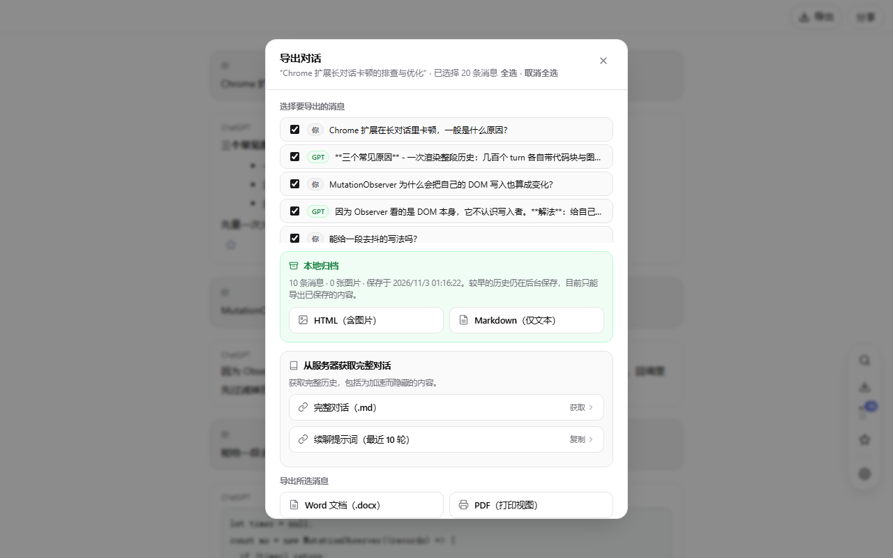
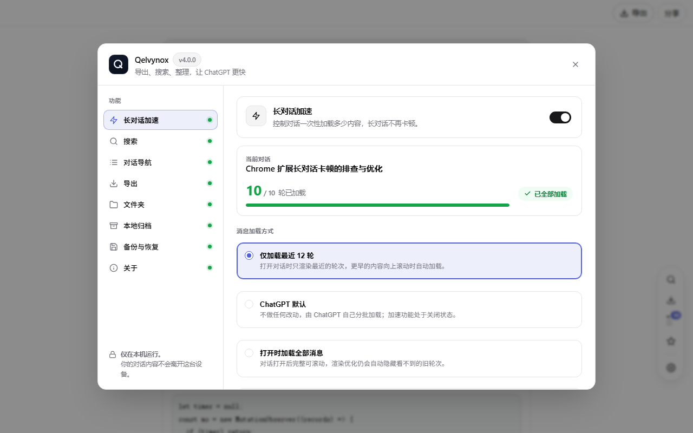
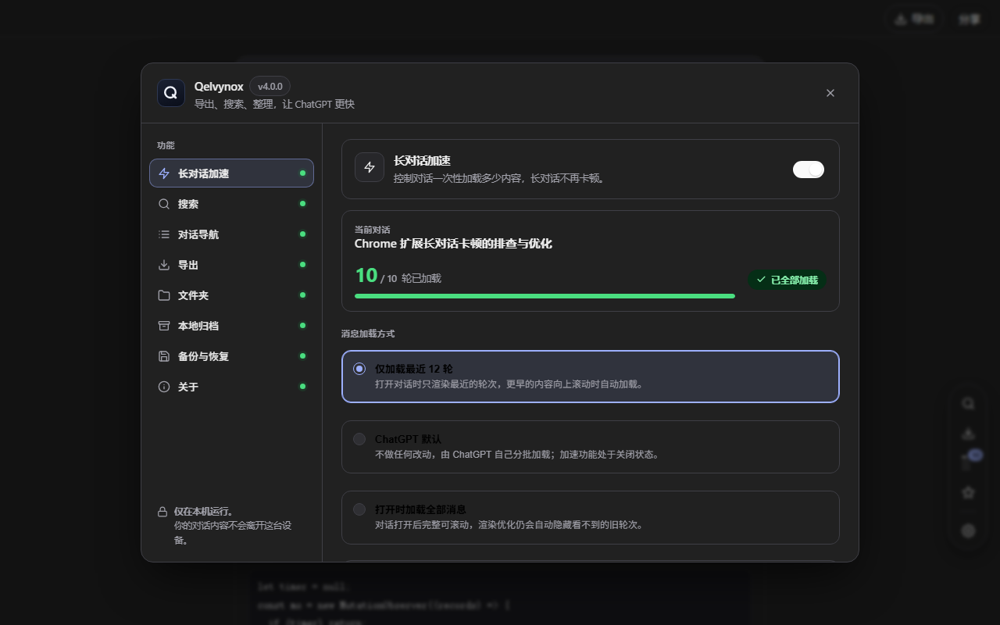

<p align="center">
  <a href="assets/qelvynox-poster.jpg"></a>
</p>

<h1 align="center">Qelvynox 简体中文</h1>

<p align="center"><strong>让 ChatGPT 长对话不再卡顿，并且把对话真正留下来。</strong><br>
加速长对话 · 对话内搜索 · 问题导航 · 回复收藏 · 本地归档 · 多格式导出</p>

<p align="center">
  <a href="README.md">English</a> · <a href="#语言">语言</a> · <a href="CHANGELOG.md">更新日志</a> · <a href="CONTRIBUTING.md">参与贡献</a> · <a href="docs/privacy.md">隐私说明</a>
</p>

<p align="center">
  
  
  
  
</p>

<p align="center">
  <a href="https://github.com/WeFode/Qelvynox">GitHub</a> ·
  <a href="https://gitee.com/lin_30_0/qelvynox">Gitee 镜像</a>
</p>

> 上方为最初发布的宣传海报，其中的**文件夹**板块与 `v4.0` 角标已经过时：文件夹功能在本
> 版本之前已移除，当前扩展版本号为 `1.0.0`。下文 [界面预览](#界面预览) 里的截图都由真实界面渲染。

完全免费，永久免费。没有账号、没有订阅、没有广告、没有专业版分层、没有遥测。
所有处理都在浏览器内完成，你的提问、回复和图片都不会离开这台设备。

> Qelvynox 之前叫 **TurboGPT**。老版本的设置与收藏会在首次加载时自动迁移，不会丢失。

---

## 界面预览

| 对话导航 | 对话内搜索 |
| --- | --- |
|  |  |

| 回复收藏 | 导出对话 |
| --- | --- |
|  |  |

| 设置面板（浅色） | 设置面板（深色） |
| --- | --- |
|  |  |

---

## 语言

界面内置**中文与英文**，在产品里就能切换：**设置 → 通用 → 界面语言**，或工具栏弹窗顶部的分段控件。切换立即生效，不需要重新加载，并且会记住。

- **默认是中文**，不跟随浏览器语言。语言是一项用户设置，绝不从 `navigator.language` 猜。不合适的值会回退到中文。
- 切换只影响 Qelvynox 自己的面板、提示、气泡通知以及导出文件里的标签；你的对话正文不会被翻译。
- 商店条目与 Chrome 自己的扩展界面走另一套机制，由 `_locales/zh_CN` 与 `_locales/en` 本地化。

新增第三语言只需在 `src/shared/i18n.js` 里多一张对照表、在 `_locales/` 下多一个目录，其余代码里不存在任何文案。

---

## 功能

### 长对话加速
ChatGPT 会把已加载的每一轮都渲染出来，几百轮的对话因此变成幻灯片。Qelvynox 只让最近若干轮参与布局，其余留在页面内存里——**不删除任何 React 持有的节点**。

- 隐藏旧轮次的包裹层并重算虚拟滚动轨道，React 的 fiber 树保持有效。直接移除节点正是 ChatGPT 报 “Oh no! An error occurred” 的原因。
- 三种加载方式：仅加载最近 N 轮 / ChatGPT 默认 / 打开时加载全部。
- 向上滚动即自动分批揭示较早内容，滚动位置逐像素锚定，不跳、不闪、无需点按钮。
- 标签页切到后台时完全停止渲染，回到前台再补齐。

### 对话内搜索（`Alt + F`）
输入关键词，对话中**每一处**出现的位置都会原地高亮，第一处滚到屏幕中央，`Enter` / `Shift+Enter` 逐条跳转。

- 使用浏览器 Custom Highlight API 上色，不改写 ChatGPT 的 DOM，React 重渲染也不会吃掉标记。
- 搜索范围是页面已加载的全部轮次，包括为加速折叠掉的内容——跳转时会自动展开。
- 搜索栏打开时新到的回复也会被搜索：面板随流式输出重绘，并做了节流，不会与页面抢主线程。

### 对话导航
鼠标悬停右侧目录按钮即展开问题列表，点击可钉住。滚动时，视口中央正在阅读的那条问题会同步高亮并保持在可视范围内，面板因此是一张位置地图，而不只是一串链接。分屏多对话也已适配：列表只描述你正在看的那个对话，不会把两个对话叠在一起。点击任意问题会滚到该轮并亮起光晕；被折叠的会先展开。列表项也可以 `Tab` 聚焦、`Enter` 跳转。

### 回复收藏
每条回答旁都有星形按钮。收藏集中在悬浮栏的星形按钮上，可在「本对话 / 全部」之间切换、悬停删除；收藏来自其他对话时会打开对应对话，来自当前对话则直接跳转并展开。

### 本地归档（含图片，秒级导出）
再向 OpenAI 请求一次完整对话，正是那个会被限流、拒绝或中途截断的请求。本地归档把这个请求彻底去掉：

- 直接取自 **ChatGPT 打开对话时自己加载的那份数据**，不多发一个请求。
- 边聊边存：每条回复流式结束后写入本机，并用一次限频同步拿到最新轮次的真实 id。
- 较早的历史在后台逐页补齐，每次一页、间隔数秒，下次打开从最旧的一页继续。
- 图片在签名链接失效前按字节保存为本机文件。
- 两种即时导出只读本机：**自包含 HTML**（图片全部内嵌，离线永久可看）与 **Markdown**（在图片位置留下标记）。
- 临时对话一律不归档；设置面板里可一键查看占用并删除归档。

### 勾选导出
勾选需要的消息后导出：

| 格式 | 说明 |
| --- | --- |
| **Word (.docx)** | 从零构造的合法 OOXML（内置最小 ZIP 写入器 + CRC32），不依赖任何库；代码块保留等宽与底纹。 |
| **PDF** | 打印视图，按 Markdown 排版而非压平纯文本。 |
| **Markdown / TXT / JSON** | 结构保留：围栏代码保留语言、链接保留 URL、列表与表格保持形状。 |
| **HTML** | 来自本地归档，图片内嵌，从右到左文本排版正确。 |

### 完整对话导出与续聊
针对已经触到 ChatGPT 长度上限、无法再发消息的对话：

- **完整对话 (.md)** 从对话 API 逐页取回所有轮次（包括被加速隐藏的），且不会把它们塞进页面。
- **续聊提示词** 复制一段可直接粘贴的内容：最近 N 轮 + 让模型继续而不是重来的说明。

新建对话、附上导出的 `.md`、粘贴提示词，即可接着聊。若拉取未能走完，导出会写明走到了哪里、为什么；**部分归档绝不会被当作完整**。

## 隐私与权限

**Qelvynox 不向开发者发送对话数据**：没有统计、没有崩溃上报、没有更新探测、没有远端开关，代码里也不存在任何自有服务器。详见 [docs/privacy.md](docs/privacy.md)。

| 权限 | 用途 |
| --- | --- |
| `chatgpt.com` / `chat.openai.com` 页面访问 | 产品本身：工具栏就渲染在对话里。 |
| `storage`、`unlimitedStorage` | 设置与本地归档保存在本机。 |
| `*.oaiusercontent.com` 主机访问 | 为归档取回图片字节。仅 HTTPS、仅 ChatGPT/OpenAI 域名、仅接受本扩展自己脚本发起的请求。 |

不使用 `tabs`、不使用 `activeTab`、不读取浏览历史、不申请宽泛主机权限、不加载远程代码——所有代码都随包分发。

---

## 安装

**Chrome 应用商店**（推荐）：搜索 *Qelvynox*，点击「添加至 Chrome」。Chrome、Edge、Brave、Opera、Vivaldi 均可用。

**从源码加载**（无需构建、无需依赖）：

```bash
git clone https://github.com/WeFode/Qelvynox.git     # 国内网络更快：git clone https://gitee.com/lin_30_0/qelvynox.git
```

1. 打开 `chrome://extensions`，开启右上角「开发者模式」。
2. 点击「加载已解压的扩展程序」，选择本仓库目录（含 `manifest.json`）。
3. 打开或刷新 [ChatGPT](https://chatgpt.com)，右侧出现悬浮工具栏，点击齿轮进入设置面板。

已加载过的话，在扩展管理页点击 Qelvynox 的「重新加载」，再刷新 ChatGPT 页面即可。

---

## 快捷键

| 按键 | 作用 |
| --- | --- |
| `Alt + F` | 在当前对话中搜索 |
| `Enter` / `Shift + Enter` | 下一处 / 上一处 |
| `Tab` + `Enter` | 不用鼠标也能逐条走导航列表并跳转 |
| `Esc` | 关闭搜索、导航、收藏、导出与设置 |

---

## 开发与测试

无需构建、零依赖：

```bash
node tests/run.mjs      # 11 个套件、543 条断言
node dev/serve.mjs      # http://127.0.0.1:8123/c/demo-chat
node dev/shots.mjs      # 用真实 UI 重新生成本文全部截图
```

每个测试套件都会把**真实的**扩展源码载入 `node:vm`，桩接浏览器全局后用脚本化的网络与 DOM 驱动它——覆盖负载裁剪、向前分页、轮次统计、历史补齐、状态回传、临时对话、归档合并与安全 HTML、导出管线、设置面板、面板实时更新、双语字典与发布清单。

`dev/` 目录不会随扩展分发。

---

## 仓库

| 平台 | 地址 | 定位 |
| --- | --- | --- |
| GitHub | <https://github.com/WeFode/Qelvynox> | 主仓库，issue 与 PR 请开在这里。 |
| Gitee | <https://gitee.com/lin_30_0/qelvynox> | 镜像，国内网络拉取更快。 |

两个远程在维护者的工作副本里分别配为 `origin`（GitHub）与 `gitee`（Gitee），主分支为 `main`：

```bash
git remote add origin https://github.com/WeFode/Qelvynox.git
git remote add gitee  https://gitee.com/lin_30_0/qelvynox.git
git push -u origin main      # 首次推送
git push -u gitee  main      # 同步镜像
```

---

## 发布流程

完整清单在 `docs/store-listing.md`（上传件尺寸、中英文条目文案、每条权限的理由、数据使用回答、以及点击发布前需要逐项核对的内容）。简版：

1. Chrome Web Store 开发者后台注册（个人账号 $5 一次性），完成开发者资料与付款。
2. 本地跑 `node tests/run.mjs`（必须全绿）与 `node dev/package.mjs`，得到 `qelvynox-<version>.zip`（不含 `dev/`、`tests/`、`docs/`、`screenshots/` 与海报）。
3. 后台「添加新条目」上传 zip；按文档填写默认条目语言 `zh-CN` 与第二语言 `en` 的名称、摘要、详情、单一用途与权限理由。
4. 上传 8 张 1280×800 截图与 440×280 宣传图；仓库里的 `assets/qelvynox-poster.jpg`（由根目录 `Qelvynox宣传海报.png` 压缩而来）只用于 README，上面仍写着已移除的文件夹功能与旧版本号，不能直接作为商店素材。
5. 挂出一个公开可访问的隐私政策 URL（`docs/privacy.md`，已含中英双语；商店要求无需登录就能打开，请优先用 GitHub Pages 的页面地址，不要填 `blob` 或 `raw.githubusercontent.com` 链接），根据扩展实际处理的数据填写数据使用声明，不要全部选「不收集」。
6. 分类 Productivity、受众全部人群、自评无广告/内购/赌博/挖矿；核对清单后提交审核。

---

## 许可

[MIT](LICENSE) — 个人与商业用途均免费。

Copyright (c) 2026 WeFode (Qelvynox) 及贡献者。
Qelvynox 是独立的非官方工具，与 OpenAI 无隶属或认可关系。
